# Trackit

Trackit is an internal IT incident and work-management application. Employees report problems and complete assigned work; department Leads manage projects, assign work, and pass tickets; administrators manage accounts and review organization-wide performance.

This guide explains the implemented architecture, important source files, storage, security, setup, and deployment. Mermaid diagrams render on supported Markdown viewers, including GitHub. Configuration examples contain no real credentials.

## Contents

- [Features and roles](#features-and-roles)
- [System architecture](#system-architecture)
- [Project structure](#project-structure)
- [Spring Boot and MongoDB](#spring-boot-and-mongodb)
- [Frontend architecture](#frontend-architecture)
- [Signup and approval](#signup-and-approval)
- [Authentication and Spring Security](#authentication-and-spring-security)
- [Login rate limiting](#login-rate-limiting)
- [Departments and projects](#departments-and-projects)
- [Incidents and work assignments](#incidents-and-work-assignments)
- [AI drafting and routing](#ai-drafting-and-routing)
- [Department transfers](#department-transfers)
- [Messages and attachments](#messages-and-attachments)
- [SLAs and deadlines](#slas-and-deadlines)
- [Analytics](#analytics)
- [Database design](#database-design)
- [API reference](#api-reference)
- [Local setup](#local-setup)
- [Configuration](#configuration)
- [Testing](#testing)
- [Deployment](#deployment)
- [Implementation boundaries](#implementation-boundaries)
- [Code-reading roadmap](#code-reading-roadmap)

## Features and roles

| Stored role | UI name | Responsibilities |
|---|---|---|
| `EMPLOYEE` | Employee | Report incidents, review AI drafts, perform assigned work, participate in ticket messages |
| `ENGINEER` | Lead | Manage own department's projects and employees, assign work, review routing, pass tickets, view team analytics |
| `ADMIN` | Administrator | Approve accounts, manage users/departments, oversee incidents, projects, work, and analytics |

`ENGINEER` is the stored/API role; the frontend calls it **Lead**. Approval creates an employee account; an admin can change its role afterward.

Features include incident filtering/pagination, multi-employee assignments, project tasks, file attachments, human ticket conversations, transfer history, SLA tracking, deadline alerts, and analytics. AI assists with form drafting and department recommendations. Core workflows remain available when AI cannot answer.

## System architecture

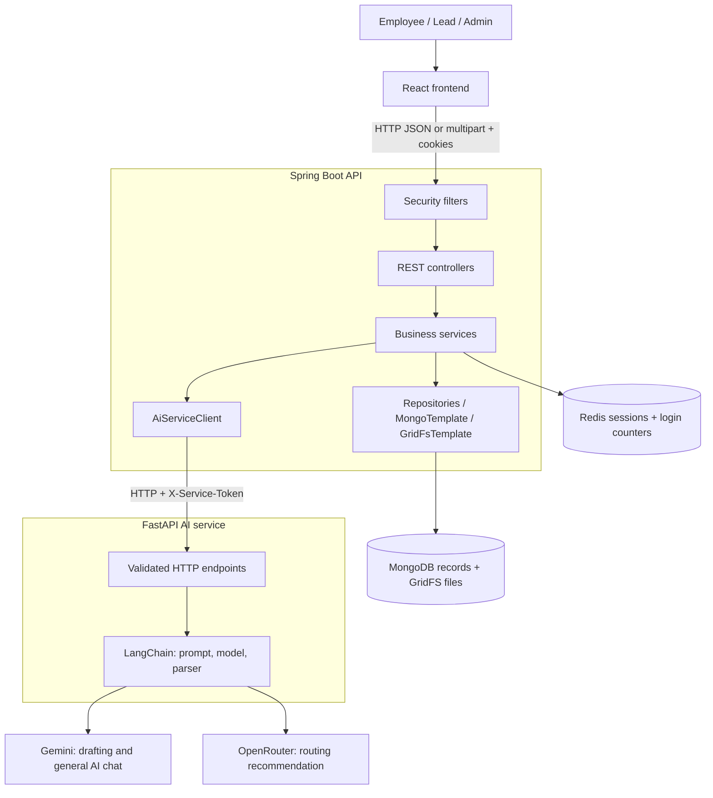

The browser calls Spring Boot. Spring owns authorization, business rules, and persistence. Python receives descriptions and department lists through HTTP, invokes models, and returns structured output. Python has no application database integration.

| Component | Technology | Local address |
|---|---|---|
| Frontend | React 19, React Router 7, Axios, Vite 8, CSS | `http://localhost:5173` |
| Main API | Java 21, Spring Boot 3.3.13, Spring Security, Spring Data MongoDB, Redis | `http://localhost:8081` |
| AI API | Python, FastAPI, Pydantic, LangChain | `http://localhost:8000` |
| Durable data | MongoDB and GridFS | Configured URI |
| Sessions and login counters | Redis | Defaults to `redis://localhost:6379` |

The AI integration invokes existing hosted models. This repository does not train an ML model or implement a vector database/RAG pipeline.

## Project structure

```text
.
├── README.md
├── render.yaml                         Render services
├── frontend/
│   ├── package.json                    Dependencies and scripts
│   ├── vite.config.js                  React plugin and dev server
│   ├── vercel.json                     SPA rewrites and HTTP headers
│   └── src/
│       ├── main.jsx                    Router and AuthProvider
│       ├── App.jsx                     URL-to-page mapping
│       ├── index.css                   Shared responsive styling
│       ├── api/                        Axios and feature API calls
│       ├── context/                    Authentication/profile state
│       ├── routes/                     GuestRoute and ProtectedRoute
│       ├── pages/                      Employee, Lead, admin screens
│       ├── components/                 Forms, tables, files, chat, charts
│       ├── hooks/                      useAuth and useNow
│       ├── constants/                  Roles, statuses, deadline helpers
│       └── utils/                      Validation and formatting
├── trackit/
│   ├── pom.xml                         Java dependencies and build
│   ├── mvnw / mvnw.cmd                  Maven wrapper
│   ├── Dockerfile                      Java build/runtime image
│   └── src/
│       ├── main/resources/application.yml
│       ├── main/java/com/trackit/
│       │   ├── TrackitApplication.java  Spring Boot entry point
│       │   ├── config/                 Security, indexes, async, settings
│       │   ├── controller/             HTTP endpoints
│       │   ├── service/                Business rules
│       │   ├── repository/             MongoRepository interfaces
│       │   ├── model/                  Documents and enums
│       │   ├── dto/                    Request/response records
│       │   ├── security/               JWT, cookies, sessions, rate limit
│       │   └── exception/              HTTP error translation
│       └── test/                       Java tests and configuration
└── ai service/
    ├── README.md
    ├── requirements.txt
    ├── requirements-dev.txt
    ├── pytest.ini
    ├── app/
    │   ├── main.py                     FastAPI endpoints
    │   ├── config.py                   Settings definitions
    │   ├── security.py                 Service-token verification
    │   ├── schemas.py                  Input/output validation
    │   ├── llm.py                      Model clients
    │   └── chains/
    │       ├── incident_draft.py        Description-to-form chain
    │       ├── ticket_routing.py        Department recommendation
    │       └── chat.py                  General AI assistant
    └── tests/                          Fake-model and HTTP tests
```

## Spring Boot and MongoDB

[TrackitApplication.java](trackit/src/main/java/com/trackit/TrackitApplication.java) starts the backend:

```java
@SpringBootApplication
@ConfigurationPropertiesScan
public class TrackitApplication {
    public static void main(String[] args) {
        SpringApplication.run(TrackitApplication.class, args);
    }
}
```

`@SpringBootApplication` enables configuration and component discovery under `com.trackit`. `@ConfigurationPropertiesScan` discovers typed settings. Spring creates managed objects, called beans, and supplies their dependencies.

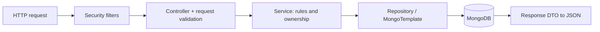

| Code concept | Purpose |
|---|---|
| `@RestController`, mappings | HTTP entry points |
| `@Service` | Business logic |
| Final dependencies + Lombok `@RequiredArgsConstructor` | Constructor dependency injection |
| Request record + `@Valid` | Define and validate input |
| Response record | Control output and resolve display names |
| `@Document`, `@Id` | Map objects to MongoDB documents |
| `MongoRepository` | CRUD and derived queries |
| `MongoTemplate` | Dynamic queries, counters, targeted updates |
| `GridFsTemplate` | File metadata/content persistence |

Spring Data MongoDB provides object-document mapping (ODM) through the MongoDB driver. There is no Hibernate/JPA layer or SQL relationship mapping. Relationships generally use string IDs resolved in services.

```java
public interface DepartmentRepository
        extends MongoRepository<Department, String> {
    boolean existsByNameKey(String nameKey);
}
```

Spring implements inherited operations such as `save` and derives queries from method names.

### Example: department creation

Files: [DepartmentController](trackit/src/main/java/com/trackit/controller/DepartmentController.java), [DepartmentService](trackit/src/main/java/com/trackit/service/DepartmentService.java), [DepartmentRepository](trackit/src/main/java/com/trackit/repository/DepartmentRepository.java), [CreateDepartmentRequest](trackit/src/main/java/com/trackit/dto/CreateDepartmentRequest.java).

```java
@PostMapping
@ResponseStatus(HttpStatus.CREATED)
@PreAuthorize("hasRole('ADMIN')")
public DepartmentResponse createDepartment(
        @Valid @RequestBody CreateDepartmentRequest request) {
    return departmentService.createDepartment(request, getCurrentUserId());
}
```

`@RequestBody` converts JSON to a record; `@Valid` applies its constraints; `@PreAuthorize` requires an admin. The service normalizes whitespace, derives a lowercase name key, checks duplicates, saves, and returns a response.

The initial duplicate check gives a useful error. A unique index handles concurrent requests that both passed that check; `DuplicateKeyException` becomes the same business error. HTTP handling, business rules, and database guarantees have separate responsibilities.

## Frontend architecture

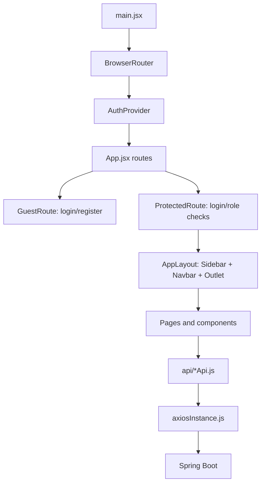

Files: [main.jsx](frontend/src/main.jsx), [App.jsx](frontend/src/App.jsx), [AuthContext.jsx](frontend/src/context/AuthContext.jsx), [axiosInstance.js](frontend/src/api/axiosInstance.js).

```javascript
const instance = axios.create({
  baseURL: configuredApiUrl || 'http://localhost:8081',
  headers: { 'Content-Type': 'application/json' },
  withCredentials: true,
  timeout: 60000,
})
```

The shared client applies address, cookies, and timeout. Its interceptor refreshes eligible failures once after a `401` or potentially stale-role `403`, excluding auth endpoints and origin-denial responses.

`AuthProvider` restores identity with `/api/auth/me`, keeps profile state in memory, and synchronizes login/logout using `BroadcastChannel`. Tokens are not in React state or local storage; local storage holds a refresh-coordination timestamp only.

Pages use local state and effects. Ignore flags/request keys prevent irrelevant responses replacing current data. Incident filters/page selection live in URL search parameters; some other screens filter loaded arrays locally. Route guards improve navigation; backend checks protect data.

## Signup and approval

Files: [Register.jsx](frontend/src/pages/Register.jsx), [AccountRequests.jsx](frontend/src/pages/AccountRequests.jsx), [AuthService](trackit/src/main/java/com/trackit/service/AuthService.java), [AccountRequestService](trackit/src/main/java/com/trackit/service/AccountRequestService.java).

```mermaid
sequenceDiagram
    participant Applicant
    participant Auth as AuthService
    participant Requests as account_requests
    participant Admin as Admin / AccountRequestService
    participant Users as users
    Applicant->>Auth: Name, email, password
    Auth->>Auth: Normalize email and BCrypt-hash password
    Auth->>Requests: Save PENDING request
    Auth-->>Applicant: 202 Accepted; no session
    Admin->>Requests: Review
    alt Approve
        Admin->>Requests: Mark APPROVED; clear request hash
        Admin->>Users: Create EMPLOYEE with employee ID
    else Reject
        Admin->>Requests: Mark REJECTED with reviewer/time
    end
```

A partial unique index permits one pending request per email. Approval uses the existing password hash, assigns an atomic `EMP-000001` style ID, and records the reviewer. Rejection retains history and the hash so matching credentials can receive a rejection explanation.

[AdminBootstrap](trackit/src/main/java/com/trackit/config/AdminBootstrap.java) creates the first admin when configured and no active admin exists, or promotes an existing matching user without replacing its password. [EmployeeIdBackfill](trackit/src/main/java/com/trackit/service/EmployeeIdBackfill.java) assigns IDs to older accounts missing them.

## Authentication and Spring Security

### Login

```mermaid
sequenceDiagram
    participant UI as Login.jsx
    participant Auth as AuthController / AuthService
    participant Manager as AuthenticationManager
    participant Details as CustomUserDetailsService
    participant Mongo as MongoDB
    participant Redis as Redis
    UI->>Auth: POST /api/auth/login
    Auth->>Redis: Check failure counter
    Auth->>Manager: Authenticate email/password
    Manager->>Details: Load user
    Details->>Mongo: Find normalized email
    Mongo-->>Manager: UserPrincipal: hash, role, active state
    Manager->>Manager: Verify password/account
    Manager-->>Auth: Authenticated principal
    Auth->>Redis: Issue refresh session
    Auth-->>UI: Profile + two HttpOnly cookies
```

Files: [SecurityConfig](trackit/src/main/java/com/trackit/config/SecurityConfig.java), [AuthController](trackit/src/main/java/com/trackit/controller/AuthController.java), [UserPrincipal](trackit/src/main/java/com/trackit/security/UserPrincipal.java), [JwtAuthenticationFilter](trackit/src/main/java/com/trackit/security/JwtAuthenticationFilter.java), [JwtService](trackit/src/main/java/com/trackit/security/JwtService.java), [AuthCookies](trackit/src/main/java/com/trackit/security/AuthCookies.java).

Authentication establishes identity; authorization decides what it may do. `UserPrincipal` implements Spring Security's `UserDetails` for login. Subsequent requests use `AuthenticatedUser` extracted from a verified JWT:

```java
AuthenticatedUser user = jwtService.parseAccessToken(token.get());
UsernamePasswordAuthenticationToken authentication =
        new UsernamePasswordAuthenticationToken(
                user, null,
                List.of(new SimpleGrantedAuthority("ROLE_" + user.role().name())));
```

The filter installs this identity in `SecurityContextHolder`; `CurrentUser.get()` retrieves it. Method security enables `@PreAuthorize` role checks; services also check ownership, department, and workflow. Default form login/HTTP Basic are disabled. JWT verification itself does not query MongoDB, though business endpoints may.

### Tokens and cookies

The access token **is a JWT**; JWT is its format, not a third token.

| Item | Browser | Backend | Purpose |
|---|---|---|---|
| Access JWT | HttpOnly cookie | No per-token record; verify signing key | Authenticate requests |
| Random refresh token | Separate HttpOnly cookie | SHA-256 hash + metadata in Redis | Renew/revoke sessions |
| User/password hash | Profile only in React memory | MongoDB | Durable account identity |

| Production cookie | Path | Default lifetime | Attributes |
|---|---|---|---|
| `__Host-trackit_at` | `/` | 10 minutes | HttpOnly, Secure, SameSite=None, Partitioned |
| `__Secure-trackit_rt` | `/api/auth` | 7 days, sliding | HttpOnly, Secure, SameSite=None, Partitioned |

`COOKIE_SECURE=false` omits secure prefixes and uses SameSite=Lax without Secure/Partitioned for local HTTP. Cross-site login depends on browser cookie policy/support; inspect cookie acceptance when troubleshooting. Hosting frontend/API under the same site can avoid third-party-cookie restrictions.

JWT claims include user ID, role, issuer, audience, token purpose, token ID, and expiry, signed with HS256. Parsing allows 30 seconds of clock skew. Signing protects integrity; it does not encrypt the payload.

### Refresh and revocation

```mermaid
sequenceDiagram
    participant Browser as Axios / cookies
    participant API as Spring Boot
    participant Redis as Redis
    participant Mongo as MongoDB
    Browser->>API: Request with expired access JWT
    API-->>Browser: 401
    Browser->>API: POST /api/auth/refresh
    API->>Redis: Atomically rotate refresh token
    alt Rotated
        API->>Mongo: Re-read active account and role
        API-->>Browser: Replacement cookies
        Browser->>API: Retry original request once
    else Concurrent refresh within grace
        API-->>Browser: 409 CONCURRENT_REFRESH; preserve cookies
    else Invalid or reused outside grace
        API-->>Browser: 401 SESSION_EXPIRED; clear cookies
    end
```

[RefreshTokenService](trackit/src/main/java/com/trackit/security/RefreshTokenService.java) uses Lua scripts for atomic issuance/rotation/revocation. Each login starts a family. Used tokens are remembered; reuse outside the default 20-second grace period revokes the family. Rotation renews refresh lifetime.

The frontend shares an in-flight refresh and uses Web Locks where available across tabs. Logout revokes the family and clears cookies. Deactivation revokes all refresh families; issued JWTs may remain accepted until expiry, including clock tolerance. New tokens reflect current roles.

### Browser protections

- [CorsConfig](trackit/src/main/java/com/trackit/config/CorsConfig.java) enables credentialed requests for configured origins, rejects a bare `*`, and supplies allowed methods/headers. Configure explicit frontend origins.
- [OriginVerificationFilter](trackit/src/main/java/com/trackit/security/OriginVerificationFilter.java) checks cross-origin writes. Requests without Origin and same-origin requests pass this check.
- Spring's CSRF-token mechanism is disabled; browser write protection uses origin verification and CORS.
- `RestSecurityErrorHandler` writes filter failures; `GlobalExceptionHandler` translates controller/service failures.
- Spring headers and [Vercel response headers](frontend/vercel.json) add browser protections. Files are served as downloads with a neutral content type.

## Login rate limiting

Files: [LoginRateLimiter](trackit/src/main/java/com/trackit/security/LoginRateLimiter.java), [LoginRateLimitProperties](trackit/src/main/java/com/trackit/security/LoginRateLimitProperties.java).

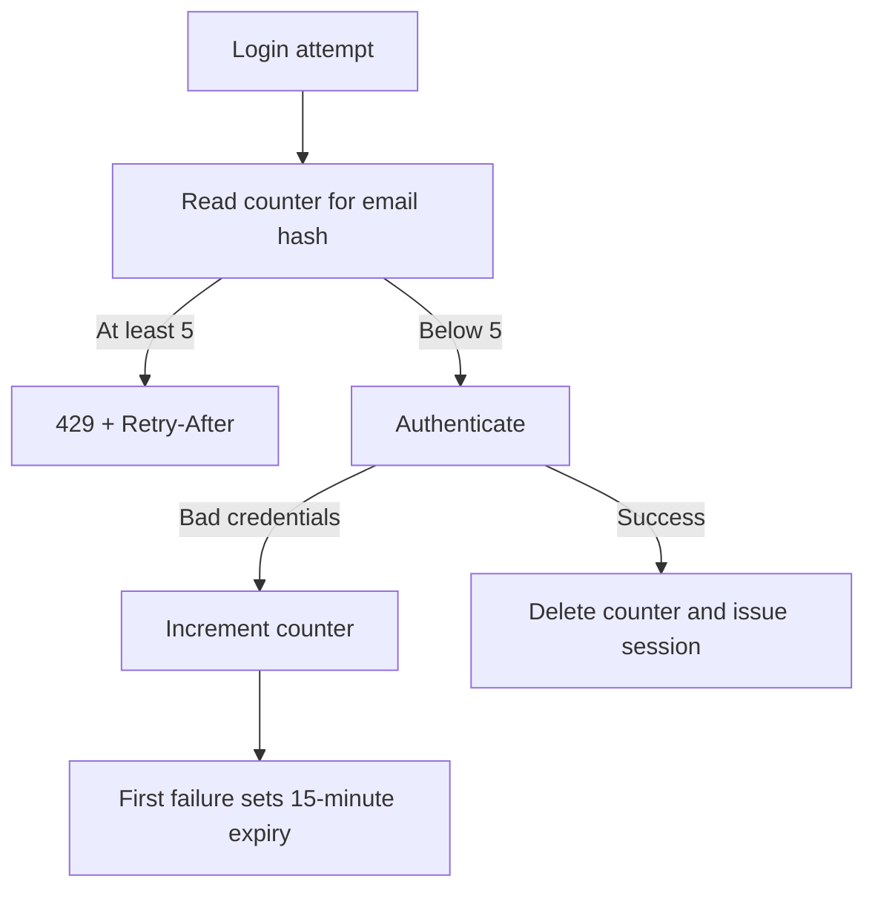

Key: `<prefix>login-fail:<SHA-256 of normalized email>`. This is per email, not IP. The same email shares a counter across IPs/instances using the same Redis. The source avoids trusting forwarded client-IP headers for this policy.

```lua
local count = redis.call('INCR', KEYS[1])
if count == 1 then redis.call('PEXPIRE', KEYS[1], ARGV[1]) end
return count
```

The script atomically increments and sets initial expiry; later failures do not extend it. After five recorded failures, attempts are blocked until expiry even with a correct password. The pre-check and verification are separate, so this is not a strict concurrent-attempt cap. There is no general API-wide or AI-endpoint limiter.

## Departments and projects

Files: [Departments.jsx](frontend/src/pages/Departments.jsx), [AdminUsers.jsx](frontend/src/pages/AdminUsers.jsx), [Team.jsx](frontend/src/pages/Team.jsx), [DepartmentService](trackit/src/main/java/com/trackit/service/DepartmentService.java), [UserService](trackit/src/main/java/com/trackit/service/UserService.java), [TeamService](trackit/src/main/java/com/trackit/service/TeamService.java).

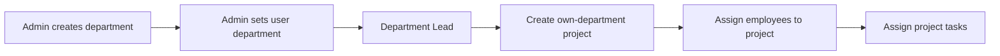

Department names are normalized and unique. Project names are unique within a department. Project statuses are `ACTIVE`, `ON_HOLD`, and `COMPLETED`; completed projects reject new tasks and new membership. Each employee has one `projectId`, not a many-to-many membership list.

Admins cannot belong to a department. Changing department clears project membership; non-employee roles cannot retain a project. The backend protects the last active admin against demotion/deactivation. The UI also disables self-role changes and self-deactivation controls.

## Incidents and work assignments

### Creating and browsing incidents

Files: [CreateIncident.jsx](frontend/src/pages/CreateIncident.jsx), [Incidents.jsx](frontend/src/pages/Incidents.jsx), [IncidentDetail.jsx](frontend/src/pages/IncidentDetail.jsx), [IncidentController](trackit/src/main/java/com/trackit/controller/IncidentController.java), [IncidentService](trackit/src/main/java/com/trackit/service/IncidentService.java), [PriorityService](trackit/src/main/java/com/trackit/service/PriorityService.java).

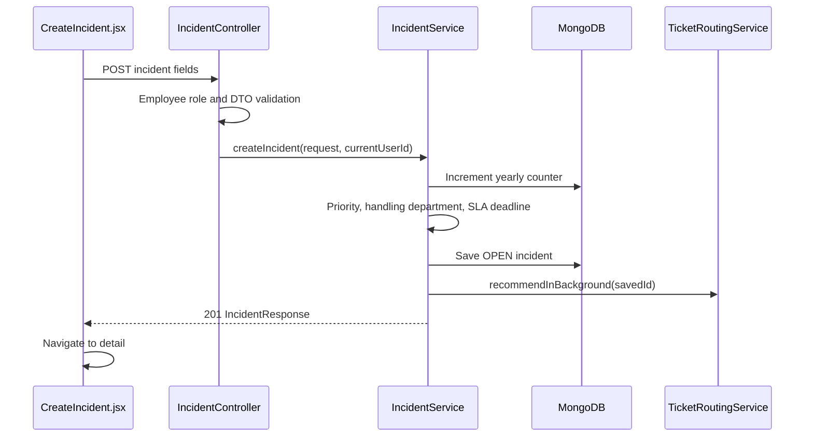

Employees supply problem details. The backend sets identity, number, status, timestamps, priority, handling department, and deadline. Numbers use an atomic counter and `INC-YYYY-000001`, using the UTC year. AI does not delay creation.

| Impact / urgency | HIGH | MEDIUM | LOW |
|---|---|---|---|
| HIGH | P1 Critical | P2 High | P2 High |
| MEDIUM | P2 High | P3 Medium | P3 Medium |
| LOW | P3 Medium | P4 Low | P4 Low |

React previews priority; Java calculates it authoritatively. The manual status endpoint uses:

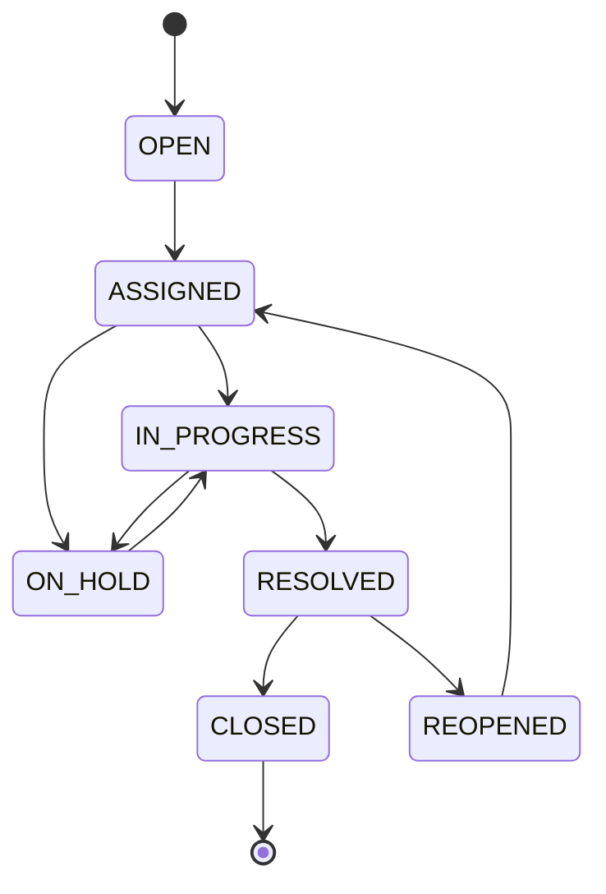

Assignment actions also synchronize status through `WorkItemService`, with transitions beyond this manual endpoint map.

- Employees list their reported incidents; direct detail also permits employees with non-declined ticket work.
- Leads see tickets assigned to them, reported by their department's members, or handled by their department.
- Admins see all active incidents.
- Reporter employees edit only while `OPEN`; the update DTO supports title, description, and affected service.
- Manual status changes require Lead/admin; a Lead must be the incident's assigned Lead.
- Admin deletion sets `active=false`, retaining the document.

Filtering combines visibility and requested filters in MongoDB. Title search in the current incident screen filters only the loaded page.

### Individual work items

Files: [TeamWork.jsx](frontend/src/pages/TeamWork.jsx), [MyWork.jsx](frontend/src/components/MyWork.jsx), [workApi.js](frontend/src/api/workApi.js), [WorkItemService](trackit/src/main/java/com/trackit/service/WorkItemService.java), [WorkItem](trackit/src/main/java/com/trackit/model/WorkItem.java).

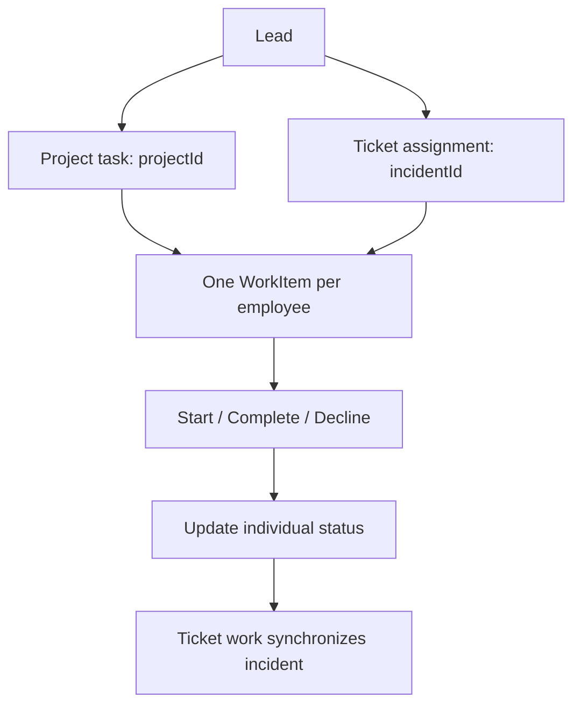

`Incident.assignedTo` identifies the Lead; `WorkItem.assignedTo` identifies an employee. `handlingDepartmentId` identifies the responsible department. Several employees can contribute independently to one ticket.

Project tasks require active department employees on the project and include description, due date/time, and optional file IDs. Ticket assignments require handling-department employees and reject duplicate unfinished assignments for the same employee.

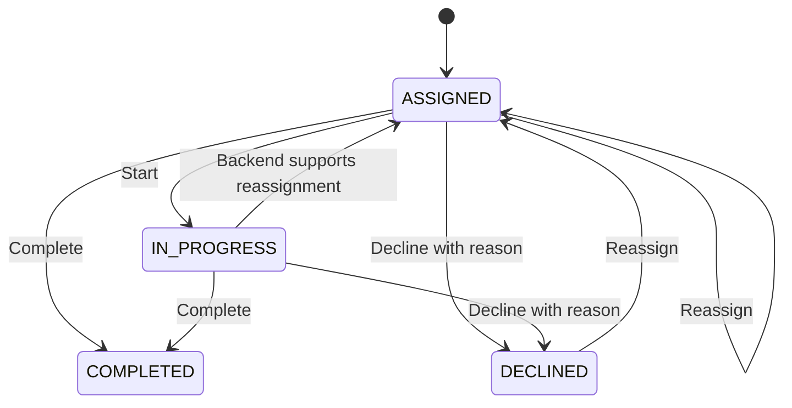

The Lead UI exposes reassignment for assigned/declined work; Java also accepts in-progress reassignment but rejects completed work. Reassignment resets assignment time, status, and decline reason.

Ticket completion checks every assignment:

```java
boolean allDone = workItemRepository
        .findByIncidentIdOrderByCreatedAtAsc(item.getIncidentId()).stream()
        .allMatch(w -> w.getStatus() == WorkItemStatus.COMPLETED);
```

Only then does the ticket resolve. Declined work remains unfinished. If nobody is in progress after decline/reassignment, an in-progress ticket can return to `ASSIGNED`; this is separate from SLA `ON_HOLD`.

## AI drafting and routing

Files: [AiDraftBox.jsx](frontend/src/components/AiDraftBox.jsx), [IncidentDraftService](trackit/src/main/java/com/trackit/service/IncidentDraftService.java), [AiServiceClient](trackit/src/main/java/com/trackit/service/AiServiceClient.java), [TicketRoutingService](trackit/src/main/java/com/trackit/service/TicketRoutingService.java), [Python endpoints](ai%20service/app/main.py), [schemas](ai%20service/app/schemas.py), [model clients](ai%20service/app/llm.py).

### Drafting

```mermaid
sequenceDiagram
    participant UI as AiDraftBox
    participant Controller as IncidentController
    participant Draft as IncidentDraftService
    participant Client as AiServiceClient
    participant Python as FastAPI / draft chain
    participant Model as Gemini
    UI->>Controller: POST /api/incidents/draft
    Controller->>Draft: draft(description)
    Draft->>Client: draftIncident(description)
    Client->>Python: POST /api/incident-draft + service token
    Python->>Model: Prompt and description
    Model-->>Python: Structured answer
    Python->>Python: Pydantic parsing/validation
    Python-->>Draft: JSON draft
    Draft->>Draft: Cap text and normalize enums/defaults
    Draft-->>UI: Editable form; nothing saved
```

The Java drafting endpoint is in `IncidentController`, not a separate `IncidentDraftController`. Internal Java code calls services directly because controllers are HTTP boundaries. The Java-to-Python boundary uses HTTP because they are separate applications.

The [draft chain](ai%20service/app/chains/incident_draft.py) composes:

```python
return prompt | (llm or get_llm()) | parser
```

The prompt defines fields/formats; Gemini responds; `PydanticOutputParser` validates the schema. Tests inject a fake `llm`. Java caps lengths and normalizes enum values again. Employees review the form and separately submit the ordinary incident endpoint.

### Routing

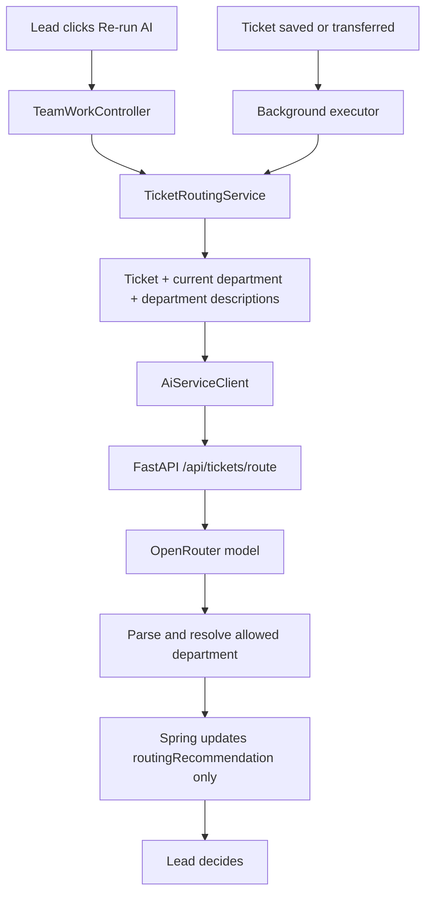

The [routing chain](ai%20service/app/chains/ticket_routing.py) defaults to `typesafe/jev-router`. It receives ticket fields, current department, and up to 50 departments. Python resolves an allowed ID or matching name and rejects choices outside the list.

Output includes department, confidence, reason, stay/move decision, model, and optional handoff-note draft. The API carries that note, but the current transfer panel initializes its note empty. Recommendations are embedded in incidents.

[AsyncConfig](trackit/src/main/java/com/trackit/config/AsyncConfig.java) supplies 2 core/4 maximum threads, queue size 100, and discard-oldest rejection behavior. Targeted recommendation writes avoid replacing unrelated fields, but are not a complete transactional stale-recommendation guarantee.

Java defaults to 10-second connect/55-second read timeouts; Python has its own timeouts/retries. Interactive failures become AI-unavailable responses; background failures are logged. The ticket remains usable without a suggestion.

Python `/api` endpoints optionally require `X-Service-Token`; provider keys stay on Python. Health flags indicate configuration presence, not a live provider test. General `/api/chat` exists separately and is not used by React ticket messages.

## Department transfers

Files: [PassTicketPanel.jsx](frontend/src/components/PassTicketPanel.jsx), [TicketTransfers.jsx](frontend/src/components/TicketTransfers.jsx), [TicketTransferService](trackit/src/main/java/com/trackit/service/TicketTransferService.java), [TicketDepartments](trackit/src/main/java/com/trackit/service/TicketDepartments.java).

```mermaid
sequenceDiagram
    participant Lead as Handling department Lead
    participant Transfer as TicketTransferService
    participant Mongo as MongoDB
    participant AI as TicketRoutingService
    Lead->>Transfer: Destination and optional note
    Transfer->>Transfer: Check ownership/status/destination
    Transfer->>Mongo: Check no unfinished work
    Transfer->>Mongo: Update department; clear Lead/suggestion
    Transfer->>Mongo: Append transfer history
    Transfer->>AI: Generate receiving-department recommendation
    Transfer-->>Lead: Transfer response
```

Transfer requires the handling department's Lead, an active unfinished ticket, a different existing destination, and no assigned/in-progress/declined work. Reassigning unfinished work does not remove this restriction.

Transfer clears Lead assignment/suggestion; an `ASSIGNED` incident returns to `OPEN`. A destination without an active Lead is allowed, with a UI explanation. History records departments, actor, note, timestamp, and whether the destination matched the suggestion. Older tickets missing handling department fall back to the reporter's current department.

## Messages and attachments

### Human ticket messages

Files: [TicketChat.jsx](frontend/src/components/TicketChat.jsx), [TicketChatController](trackit/src/main/java/com/trackit/controller/TicketChatController.java), [TicketChatService](trackit/src/main/java/com/trackit/service/TicketChatService.java).

Messages reference incidents, preserving history through reassignment. Employee reporters/non-declined assignees may post; closed tickets are read-only. Admins observe. Lead observation checks assignment to the Lead or the reporter's department, so chat scope is narrower than detail scope after some transfers.

Messages load on opening, Refresh, and sending. There is no WebSocket/server push. Bodies are limited to 2,000 characters. This is human conversation, not model chat.

### Attachments

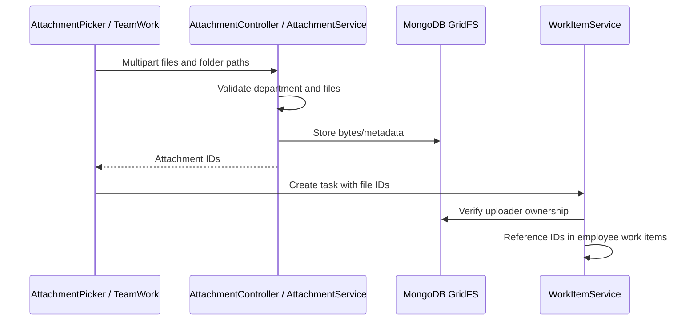

Files: [AttachmentPicker.jsx](frontend/src/components/AttachmentPicker.jsx), [AttachmentList.jsx](frontend/src/components/AttachmentList.jsx), [AttachmentService](trackit/src/main/java/com/trackit/service/AttachmentService.java).

Limits: 20 files, 10 MB each, 50 MB multipart request. Folder paths are sanitized and retained. Metadata records uploader/department; task copies share file references. Download checks uploader, admin, same-department Lead, or assigned work referencing the file. Responses use attachment disposition, `application/octet-stream`, and `nosniff`. Upload/task creation are separate; no orphan-upload cleanup job is implemented.

## SLAs and deadlines

Files: [SlaService](trackit/src/main/java/com/trackit/service/SlaService.java), [SlaScheduler](trackit/src/main/java/com/trackit/service/SlaScheduler.java), [SlaProperties](trackit/src/main/java/com/trackit/config/SlaProperties.java), [SlaBadge.jsx](frontend/src/components/SlaBadge.jsx), [work.js](frontend/src/constants/work.js).

| Priority | Default resolution target |
|---|---|
| P1 | 4 hours |
| P2 | 8 hours |
| P3 | 3 days |
| P4 | 5 days |

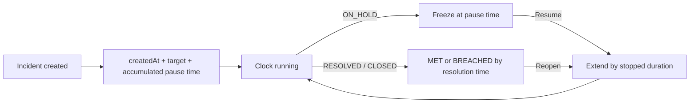

SLA uses calendar time. `DUE_SOON` starts when the final configured share remains (20% default); `BREACHED` means the deadline was exceeded. Resolved/closed tickets are met/breached by resolution time. On hold freezes the clock; reopening resumes and accounts for stopped time.

A scheduler updates stored running states every minute after a 30-second delay; responses also calculate live status. Startup backfills older active incidents missing deadlines.

Project tasks use local due date/time. Frontend helpers flag active work after 80% of its assignment-to-deadline interval or when overdue. `useNow` updates labels each minute; employee navbar alerts re-fetch on navigation/every five minutes. Task-date alerts differ from ticket SLA calculations.

## Analytics

Files: [AnalyticsController](trackit/src/main/java/com/trackit/controller/AnalyticsController.java), [AnalyticsService](trackit/src/main/java/com/trackit/service/AnalyticsService.java), [AdminAnalytics.jsx](frontend/src/pages/AdminAnalytics.jsx), [TeamAnalytics.jsx](frontend/src/pages/TeamAnalytics.jsx), [AnalyticsWidgets.jsx](frontend/src/components/AnalyticsWidgets.jsx).

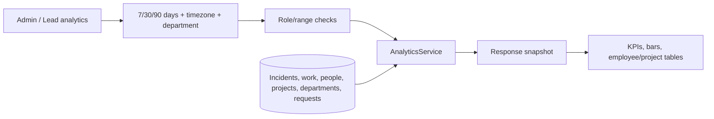

Metrics include open incidents, breaches, compliance, resolution time, overdue work, on-time delivery, projects, and people. Leads receive own-department employee/project breakdowns. Admins select one department or all.

Day boundaries use the requested timezone, falling back to UTC. Short ranges use daily buckets; 90 days uses weekly buckets. Rates are null when nothing is measurable. Current totals differ from `InRange` values. Incident attribution follows the reporter's current department; work uses work-item department. Pending requests are organization-wide. Calculations load records and aggregate in Java, not a separate analytics warehouse.

## Database design

### Collections

| Collection | Stored data |
|---|---|
| `users` | Employee ID, name/email, password hash, role, expertise, department/project IDs, active flag, created time |
| `account_requests` | Applicant/hash, status, reviewer, timestamps, version |
| `departments` | Name/key, description, creator/time |
| `projects` | Name/key, department, status, creator/time |
| `incidents` | Number, content, priority/workflow, reporter/Lead/department, SLA, nested AI suggestion, active flag, version |
| `work_items` | Type/content, department/project/incident, employee/Lead, status, deadline, files, decline reason, timestamps, version |
| `ticket_messages` | Incident, author, body, created time |
| `ticket_transfers` | Incident, departments, actor, note, followed-suggestion flag, time |
| `counters` | Atomic employee/yearly incident sequences |
| `fs.files`, `fs.chunks` | GridFS metadata/content |

### Logical relationships

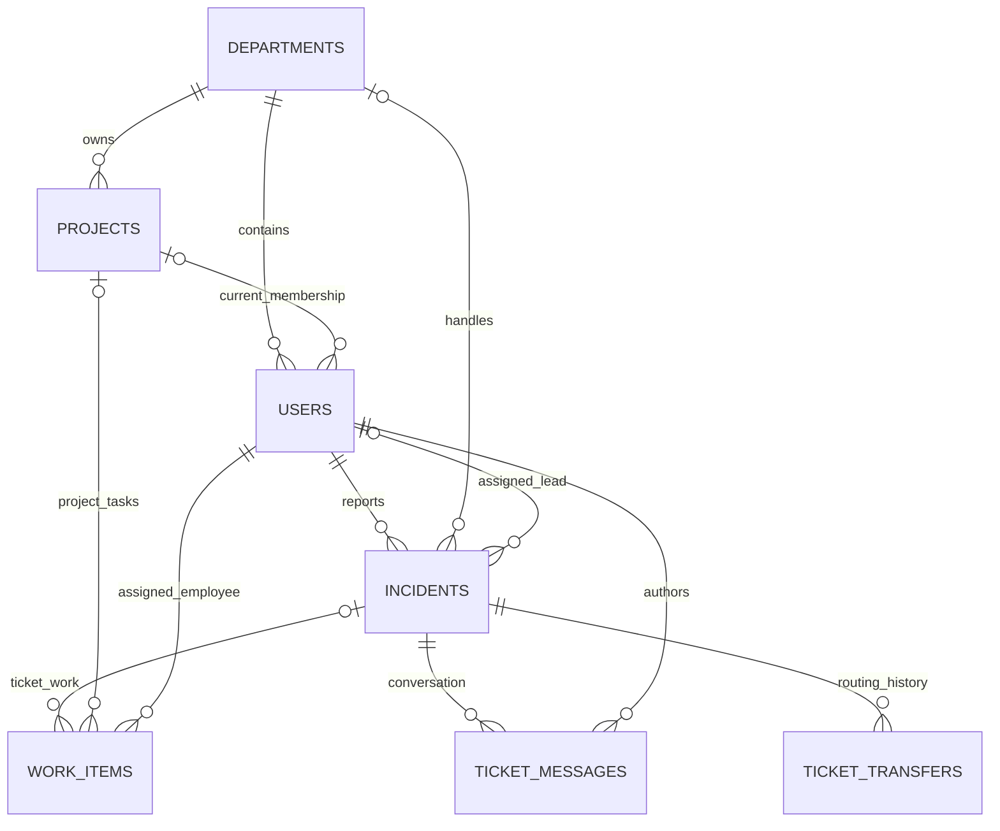

These are logical references, not SQL foreign keys. Services resolve IDs, often in batches, to response names. A work item references a project or incident according to type; routing suggestions are embedded.

### Indexes and concurrency

[MongoConfig](trackit/src/main/java/com/trackit/config/MongoConfig.java) creates indexes for filters/relations, unique incident number, department name, project department/name, employee ID, pending-request email, message ordering, and SLA queries. User email is uniquely indexed on the model.

`@Version` on incidents, work, and requests detects stale saves and produces `409`. Counters use atomic `findAndModify`; targeted background updates avoid replacing unrelated fields. Multi-document workflows are not application-level MongoDB transactions; optimistic locking is not cross-document atomicity.

### Redis keys

All use the configurable prefix, default `trackit:`.

| Suffix | Value / purpose |
|---|---|
| `rt:<hash>` | Live refresh metadata: user/family |
| `rt-used:<hash>` | Family/rotation time for reuse detection |
| `fam:<familyId>` | Current refresh hash for revocation |
| `user-fams:<userId>` | Family set for revoke-all |
| `login-fail:<emailHash>` | Failed-login count and expiry |

## API reference

These are Spring endpoints unless marked Python. Role checks are supplemented by service ownership rules.

### Authentication and administration

| Method | Path | Access / purpose |
|---|---|---|
| POST | `/api/auth/register` | Public; request account, 202 |
| POST | `/api/auth/login` | Public; cookies and profile |
| POST | `/api/auth/refresh` | Refresh cookie; rotate session |
| POST | `/api/auth/logout` | Revoke session/clear cookies, 204 |
| GET | `/api/auth/me` | Authenticated profile |
| GET | `/api/admin/account-requests` | Admin; optional status/paging |
| POST | `/api/admin/account-requests/{id}/approve` | Admin |
| POST | `/api/admin/account-requests/{id}/reject` | Admin |
| GET | `/api/admin/users` | Admin; paging and optional `q` search |
| GET | `/api/admin/users/{id}` | Admin |
| PATCH | `/api/admin/users/{id}/role` | Admin; `{role}` |
| PATCH | `/api/admin/users/{id}/department` | Admin; `{departmentId}`, null clears |
| PATCH | `/api/admin/users/{id}/status` | Admin; toggle active |
| GET / POST | `/api/admin/departments` | Admin; list/create |
| GET | `/api/admin/projects` | Admin project overview |
| GET | `/api/admin/work` | Admin work overview |
| GET | `/api/admin/analytics` | Admin; `days`, optional `tz`, `departmentId` |

### Incidents

| Method | Path | Access / purpose |
|---|---|---|
| POST | `/api/incidents` | Employee; create, 201 |
| POST | `/api/incidents/draft` | Employee; AI form fields only |
| GET | `/api/incidents` | Scoped; page/size/sort/status/priority/category/assignedTo |
| GET | `/api/incidents/dashboard/summary` | Scoped counts |
| GET | `/api/incidents/{id}` | Scoped detail |
| PUT | `/api/incidents/{id}` | Reporter employee while OPEN; supported partial fields |
| PATCH | `/api/incidents/{id}/status` | Lead/admin; `{newStatus, reason}`; current service does not persist reason |
| DELETE | `/api/incidents/{id}` | Admin; soft delete, 204 |
| GET | `/api/incidents/{incidentId}/messages` | Conversation permission |
| POST | `/api/incidents/{incidentId}/messages` | Employee participant; `{body}`, 201 |

### Team and employee work

| Method | Path | Access / purpose |
|---|---|---|
| GET | `/api/team` | Lead department/members/projects |
| POST | `/api/team/projects` | Lead; `{name}`, 201 |
| PATCH | `/api/team/projects/{id}/status` | Lead; `{status}` |
| PATCH | `/api/team/members/{id}/project` | Lead; `{projectId}`, null clears |
| GET | `/api/team/work` | Lead; department work |
| POST | `/api/team/work/tasks` | Lead; create employee task copies, 201 |
| PATCH | `/api/team/work/{id}/assignee` | Lead; reassign |
| GET | `/api/team/tickets` | Lead; unfinished handled tickets |
| POST | `/api/team/tickets/{incidentId}/assign` | Lead; `{assigneeIds, dueDate?}`, 201 |
| POST | `/api/team/tickets/{incidentId}/recommendation` | Lead; rerun AI |
| GET | `/api/team/departments` | Lead; destinations/Lead names |
| POST | `/api/team/tickets/{incidentId}/transfer` | Lead; `{toDepartmentId, note?}`, 201 |
| POST | `/api/team/attachments` | Lead; multipart files/optional JSON paths, 201 |
| GET | `/api/attachments/{id}` | Authenticated; file check |
| GET | `/api/team/analytics` | Lead; `days`, optional `tz` |
| GET | `/api/my-work` | Employee; own work |
| POST | `/api/my-work/{id}/start` | Assigned employee |
| POST | `/api/my-work/{id}/complete` | Assigned employee |
| POST | `/api/my-work/{id}/decline` | Assigned employee; `{reason}` |

### AI and operational endpoints

| Service | Method/path | Purpose |
|---|---|---|
| Spring | GET `/actuator/health` | Public health including configured database dependencies |
| Spring | GET `/swagger-ui.html`, `/v3/api-docs` | Documentation when enabled |
| Python | GET `/health` | Model names and configuration flags |
| Python | POST `/api/incident-draft` | `{description}` to form fields |
| Python | POST `/api/tickets/route` | Ticket/departments to recommendation |
| Python | POST `/api/chat` | `{question, history}` to general AI answer |
| Python | GET `/docs` | FastAPI documentation |

Python `/api` endpoints require `X-Service-Token` when configured.

### Pagination and errors

Incidents use `{content, page, size, totalElements, totalPages, last}`. Paged admin lists use `{content, page: {size, number, totalElements, totalPages}}`. Pages are zero-based and the configured maximum size is 100. Several overviews return arrays; admin work paginates its loaded array locally.

Spring errors share this structure:

```json
{
  "timestamp": "<timestamp>",
  "status": 400,
  "error": "Bad Request",
  "message": "Validation failed",
  "path": "/api/incidents",
  "fieldErrors": { "title": "Title is required" }
}
```

Optional codes: `ORIGIN_NOT_ALLOWED`, `SESSION_EXPIRED`, `CONCURRENT_REFRESH`, `AI_UNAVAILABLE`. Common statuses: 400 validation/workflow, 401 unauthenticated/session expired, 403 forbidden, 404 missing, 409 conflict, 413 oversized upload, 429 login limit, 503 unavailable AI. Python uses FastAPI errors; Java translates AI-client failures before returning them to React.

## Local setup

### Prerequisites

- Java 21+ compatible JDK.
- Node.js 20.19+ compatible with the declared Vite dependency.
- MongoDB and Redis reachable from Java.
- Python 3.11+ for optional AI.
- Gemini credentials for drafting; OpenRouter credentials/provider access for routing.

Run applications in separate terminals. Commands below use PowerShell. Supply local settings yourself and keep credentials out of Git.

### Backend

Provide environment variables or a backend-local `.env` properties file. Spring imports it from the working directory. Configure MongoDB, Redis, a Base64 signing secret of at least 256 bits, and first-admin credentials if needed. Use `COOKIE_SECURE=false` for local HTTP.

Generate a signing secret locally:

```powershell
$trackitJwtBytes = New-Object byte[] 32
$trackitRng = [System.Security.Cryptography.RandomNumberGenerator]::Create()
$trackitRng.GetBytes($trackitJwtBytes)
[Convert]::ToBase64String($trackitJwtBytes)
$trackitRng.Dispose()
```

Keep the result private and assign it to `JWT_SECRET`. From repository root:

```powershell
cd trackit
.\mvnw.cmd spring-boot:run
```

On Unix-like systems, use `./mvnw spring-boot:run` from that folder. Check [API health](http://localhost:8081/actuator/health) and [Swagger](http://localhost:8081/swagger-ui.html).

### Optional AI service

Configure `GOOGLE_API_KEY`, optional `OPENROUTER_API_KEY`, and matching service tokens on Java/Python. Provider credentials and the shared service credential are different values with different purposes.

From repository root:

```powershell
cd "ai service"
python -m venv .venv
.\.venv\Scripts\python.exe -m pip install -r requirements-dev.txt
.\.venv\Scripts\python.exe -m uvicorn app.main:app --port 8000
```

Check [AI health](http://localhost:8000/health). Configured flags are not live provider checks. See the [AI README](ai%20service/README.md) for standalone usage.

### Frontend

From repository root:

```powershell
cd frontend
npm install
npm run dev
```

Open [localhost:5173](http://localhost:5173). Set `VITE_API_URL` to override Java's address. A different frontend origin must be allowed by backend CORS.

### First walkthrough

1. Sign in as bootstrapped admin.
2. Submit and approve employee requests.
3. Create departments, assign users, and promote a user to Lead.
4. As Lead, create a project and assign employees.
5. As employee, report a ticket or review an AI draft before submission.
6. As Lead, review routing, assign work, or transfer an eligible ticket.
7. As employee, start/complete/decline work and use messages.
8. Review team/admin analytics.

## Configuration

Sources: [application.yml](trackit/src/main/resources/application.yml), [security properties](trackit/src/main/java/com/trackit/security), [AI properties](trackit/src/main/java/com/trackit/config/AiServiceProperties.java), [Python settings](ai%20service/app/config.py).

### Java API

| Setting | Default | Purpose |
|---|---|---|
| `MONGO_URI` | Placeholder; set real URI | MongoDB connection |
| `MONGO_DATABASE` | `trackit` | Database |
| `REDIS_URL` | `redis://localhost:6379` | TCP/TLS URL; `rediss://` for TLS |
| `JWT_SECRET` | Required | Base64 key, at least 256 bits |
| `ACCESS_TOKEN_TTL` | `10m` | Access lifetime |
| `REFRESH_TOKEN_TTL` | `7d` | Sliding refresh lifetime |
| `REDIS_KEY_PREFIX` | `trackit:` | Redis namespace |
| `COOKIE_SECURE` | `true` | Production cookies; false for local HTTP |
| `CORS_ALLOWED_ORIGINS` | `http://localhost:5173` | Frontend origins |
| `PORT` | `8081` | HTTP port |
| `API_DOCS_ENABLED` | `true` | Swagger/OpenAPI |
| `ADMIN_EMAIL`, `ADMIN_PASSWORD` | Empty | Bootstrap when no active admin exists |
| `ADMIN_NAME` | `Administrator` | Bootstrap name |
| `AI_SERVICE_URL` | `http://localhost:8000` | Python address |
| `AI_SERVICE_TOKEN` | Empty | Match Python `SERVICE_TOKEN` |

Other typed properties include `security.login-rate-limit.max-failures` (5), `security.login-rate-limit.window` (15m), `security.refresh-token.reuse-grace-period` (20s), JWT issuer/audience, and `trackit.ai.connect-timeout`/`timeout` (10s/55s). SLA targets use `trackit.sla.resolution.p1` through `p4`; `trackit.sla.due-soon-percent` defaults to 20. Override through Spring property binding.

### Python AI

| Setting | Default | Purpose |
|---|---|---|
| `GOOGLE_API_KEY` | Empty | Gemini credential |
| `GEMINI_MODEL` | `gemini-2.5-flash` | Draft/general chat model |
| `GEMINI_TEMPERATURE` | `0.2` | Randomness |
| `GEMINI_TIMEOUT_SECONDS` | `60` | Timeout |
| `OPENROUTER_API_KEY` | Empty | Routing credential |
| `OPENROUTER_MODEL` | `typesafe/jev-router` | Routing model |
| `OPENROUTER_BASE_URL` | `https://openrouter.ai/api/v1` | Provider address |
| `OPENROUTER_TEMPERATURE` | `0.0` | Routing randomness |
| `OPENROUTER_TIMEOUT_SECONDS` | `30` | Routing timeout |
| `SERVICE_TOKEN` | Empty, check disabled | Shared service credential |
| `CORS_ALLOWED_ORIGINS` | Empty | Optional direct browser origins |

Both clients configure up to two retries. Settings/model clients are cached; restart after settings changes.

### React

`VITE_API_URL` is embedded at build time; changes require rebuild/redeploy. The production CSP permits self and `https://*.onrender.com` connections; another API domain requires updating CSP too.

## Testing

### Frontend

```powershell
cd frontend
npm run lint
npm run build
```

Oxlint checks React/JavaScript; Vite builds assets. There is no dedicated frontend test script.

### Java

```powershell
cd trackit
.\mvnw.cmd test
```

Tests cover application context, all nine priority combinations, AI HTTP serialization/errors, routing authorization/storage, and transfer rules. Unit tests mock repositories; AI-client tests use a local HTTP server.

The context test uses embedded MongoDB and can require a binary download and reachable configured dependencies such as Redis. Context/application execution may load local settings and run startup listeners.

Focused existing unit/HTTP-contract tests:

```powershell
.\mvnw.cmd "-Dtest=PriorityServiceTest,TicketRoutingServiceTest,TicketTransferServiceTest,AiServiceClientRoutingTest" test
```

### Python

```powershell
cd "ai service"
.\.venv\Scripts\python.exe -m pytest
```

Fake models/mocked chains exercise parsing, validation, service tokens, model configuration, and failures without real provider calls. Importing settings/application code can still read local settings.

## Deployment

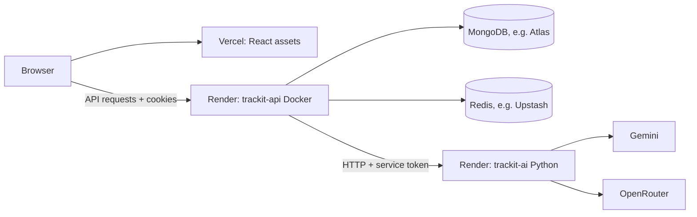

[render.yaml](render.yaml) defines Java/Python services. [Dockerfile](trackit/Dockerfile) builds with Maven/Java 21 and runs the JAR as a non-root user in a Java 21 runtime. Health paths are `/actuator/health` and `/health`.

1. Provision reachable MongoDB/Redis and configure network access. Use Redis's connection URL, not an unrelated REST URL/token.
2. Create the Render Blueprint. Supply database connections, frontend origin, bootstrap credentials, provider keys, and AI address. It generates the JWT secret and Python service token, referenced from Java.
3. Set `AI_SERVICE_URL` to Python's deployed base URL; the Blueprint does not derive it automatically.
4. Import Vercel with root `frontend` and set `VITE_API_URL` to Java's address.
5. Confirm CORS, health, cookie acceptance, login, and a protected request.

`vercel.json` provides SPA rewrites, browser headers, and asset caching. The Blueprint disables Spring API docs. Hosting sleep/cold starts can delay first requests; timeouts allow a substantial wait but cannot guarantee success through provider retries/platform delays.

## Implementation boundaries

- MongoDB ODM is used, not JPA/Hibernate or relational foreign keys.
- Leads are stored as `ENGINEER`; employee work is separate.
- AI drafts do not save tickets; suggestions do not transfer them.
- Human chat and AI chat are separate; human messages are refresh-based.
- Login limits are per email, not IP or general traffic.
- Route guards do not replace backend authorization; UI profile/role state can lag newly issued JWT permissions.
- Listing, detail, and chat have separate access scopes.
- Declined work blocks transfer; reassignment alone does not complete it.
- Multi-document and upload/task operations are not atomic as a group.
- Optimistic locking detects stale saves; background/cross-document writes need additional concurrency reasoning.
- Analytics use current records, not immutable historical membership/events.

## Code-reading roadmap

For every method, ask: **What comes in? What rules run? What is stored? What goes back?**

| Order | Read | Learn |
|---|---|---|
| 1 | `TrackitApplication`, `pom.xml`, `application.yml` | Startup/configuration |
| 2 | Department controller → DTO → service → repository → model | Complete Spring/MongoDB feature |
| 3 | `Departments.jsx`, `departmentApi.js`, `axiosInstance.js` | React-to-HTTP |
| 4 | `AuthService`, `CustomUserDetailsService`, `UserPrincipal` | Credentials |
| 5 | `SecurityConfig`, `JwtAuthenticationFilter`, `JwtService`, `CurrentUser` | Request identity/roles |
| 6 | `AuthCookies`, `RefreshTokenService`, `LoginRateLimiter`, `AuthContext` | Cookies/Redis/concurrency |
| 7 | `IncidentService`, `PriorityService`, incident DTOs | Visibility/validation/workflow |
| 8 | `TeamService`, `WorkItemService`, `TeamWork.jsx`, `MyWork.jsx` | Membership/assignments |
| 9 | `AiServiceClient`, Python routes/schemas/chains | HTTP/model contracts |
| 10 | Transfer, SLA, file, and chat services | Supporting rules |
| 11 | `AnalyticsService`, `MongoConfig`, tests | Snapshots/indexes/concurrency |

Key annotations: `@RestController` for HTTP, `@Service` for business beans, `@Configuration`/`@Bean` for configuration, `@Valid` for validation, `@PreAuthorize` for permissions, `@Document` for MongoDB, `@Version` for optimistic locking, `@Async` for background work, and `@Scheduled` for recurring work.
